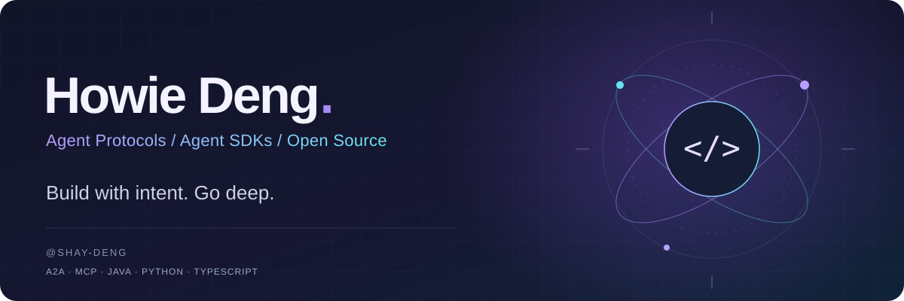

  

  <a href="#open-source">Open source</a> &nbsp; / &nbsp;
  <a href="https://github.com/Shay-Deng?tab=repositories">Repositories</a> &nbsp; / &nbsp;
  <a href="https://twitter.com/ShayDeng">Connect on X</a>

 

### Agent protocols & SDKs

I work on the plumbing that lets AI agents talk to each other: protocol conformance for **Agent2Agent (A2A)**, and fixes in the agent SDKs people build on. I write in **Java**, **Python** and **TypeScript**, and I like small, well-tested changes that are easy to review.

  
  
  
  
  
  
  
  
  

 

### Featured work

<table>
<tr><td>
 
<strong>01 &nbsp; / &nbsp; A2A PROTOCOL CONFORMANCE</strong>
<h3>Testing agents against the spec, then fixing what the tests find.</h3>

Contributing to the A2A Technology Compatibility Kit (<code>a2a-tck</code>) and running it against the reference Python SDK. One run showed that HTTP+JSON error responses were not served with the A2A media type the spec asks for; I traced it to the shared error handler and fixed it in <code>a2a-python</code>.

<code>Protocol specs</code> &nbsp; <code>JSON-RPC · HTTP+JSON · gRPC</code> &nbsp; <code>pytest</code>

<a href="https://github.com/a2aproject/a2a-python/pull/1446"><strong>a2a-python #1446 →</strong></a> &nbsp; · &nbsp; <a href="https://github.com/a2aproject/a2a-tck/pull/268">a2a-tck #268</a> &nbsp; · &nbsp; <a href="https://github.com/a2aproject/a2a-tck/pull/269">a2a-tck #269</a>

 
</td></tr>
<tr><td>
 
<strong>02 &nbsp; / &nbsp; MERGED UPSTREAM</strong>
<h3>Small, tested fixes in agent SDKs.</h3>

<strong>Google ADK</strong>: kept empty signed thinking blocks intact when replaying Claude conversation history, so multi-turn tool calls send the model exactly what it returned.

<strong>LangChain4j</strong>: made <code>StreamingModelRouter</code> signal an error, cancel upstream work and terminate exactly once on invalid demand, and kept native async chat delegation when routing.

<code>Python</code> &nbsp; <code>Java · Reactive Streams</code> &nbsp; <code>Regression tests</code>

<a href="https://github.com/google/adk-python/pull/7500"><strong>Google ADK #7500 →</strong></a> &nbsp; · &nbsp; <a href="https://github.com/langchain4j/langchain4j-community/pull/792">LangChain4j #792</a> &nbsp; · &nbsp; <a href="https://github.com/langchain4j/langchain4j-community/pull/794">#794</a>

 
</td></tr>
</table>

 

### Open source

<!-- oss:start -->
**Merged upstream:** [Google ADK](https://github.com/search?q=is%3Apr%20author%3AShay-Deng%20org%3Agoogle&type=pullrequests) · [LangChain4j](https://github.com/search?q=is%3Apr%20author%3AShay-Deng%20org%3Alangchain4j&type=pullrequests) 
**In review:** [A2A](https://github.com/search?q=is%3Apr%20author%3AShay-Deng%20org%3Aa2aproject&type=pullrequests) · [Strands Agents](https://github.com/search?q=is%3Apr%20author%3AShay-Deng%20org%3Astrands-agents&type=pullrequests) · [AgentScope](https://github.com/search?q=is%3Apr%20author%3AShay-Deng%20org%3Aagentscope-ai&type=pullrequests) · [LangGraph.js](https://github.com/search?q=is%3Apr%20author%3AShay-Deng%20org%3Alangchain-ai&type=pullrequests) · [Spring AI](https://github.com/search?q=is%3Apr%20author%3AShay-Deng%20org%3Aspring-projects&type=pullrequests)
<!-- oss:end -->

 

---

  操千曲而后晓声，观千剑而后识器。 
  Read deeply. Build thoughtfully.

